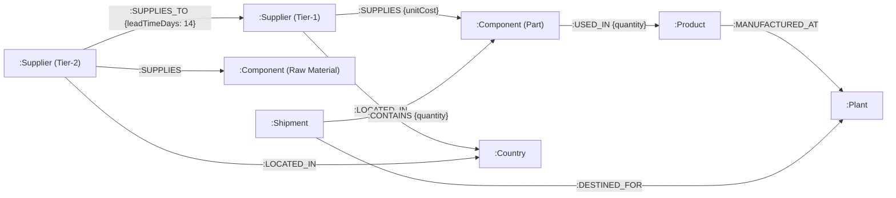
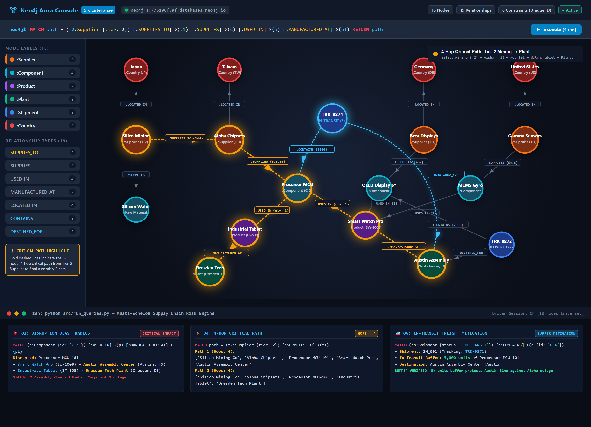

# 📦 Multi-Echelon Supply Chain Risk Knowledge Graph

[](https://neo4j.com/)
[](https://www.python.org/)
[](https://neo4j.com/docs/cypher-manual/current/)
[](https://github.com/Pavanmajji18/neo4j-knowledge-graphs-mastery)
[](https://github.com/Pavanmajji18/neo4j-knowledge-graphs-mastery)

Production-grade manufacturing supply chain knowledge graph built with **Neo4j 5.x**, **Cypher**, and **Python**. It models multi-tier vendor networks, multi-level Bill of Materials (BOM), assembly facilities, in-transit logistics shipments, and geopolitical jurisdictions to execute sub-millisecond blast-radius and root-cause analysis during supply chain disruptions.

---

## 🎯 Executive Overview & Problem Statement

Modern manufacturing supply chains operate across highly fragmented, globalized supplier tiers. Most enterprise ERP and SCM systems possess visibility only into direct Tier-1 suppliers ("first-tier myopia"). When upstream shocks occur—such as rare-earth mining freezes in Japan, semiconductor fabrication delays in Taiwan, or European port backlogs—supply chain operations teams face significant blindspots:

1. **Hidden Tier-2 Dependencies**: Inability to identify which Tier-1 suppliers depend on a common single-point-of-failure (SPOF) Tier-2 vendor.
2. **Cascading Disruption Propagation**: Difficulty calculating which downstream final assemblies and manufacturing plants will halt when a raw material or microcontroller faces lead-time inflation.
3. **Logistics in Flight**: Blindness toward whether shipments currently in transit are sufficient to buffer buffer-stock deficits before an assembly line shuts down.

This Knowledge Graph solves these challenges by treating the supply chain network as a connected property graph, enabling constant-time graph traversals across arbitrary dependency depths.

---

## 🏛️ System Design & Architecture (HLD)

### Relational RDBMS vs. Native Property Graph

Multi-echelon BOM resolution and recursive supplier trees expose fundamental performance limitations in relational databases. The table below details why a native property graph architecture was selected:

| Architectural Dimension | Relational RDBMS (SQL / Postgres) | Native Property Graph (Neo4j 5.x) |
| :--- | :--- | :--- |
| **Data Model Paradigm** | Normalized tabular schema with foreign keys and junction tables | Native labeled property graph with typed, directed, attributed edges |
| **Multi-Hop Traversal (e.g., 5-hop BOM)** | $O(b^d)$ exponential join penalty requiring repeated B-Tree index lookups per hop | $O(1)$ constant time per hop via Index-Free Adjacency (direct pointer hopping) |
| **Query Expressiveness** | Verbose, error-prone recursive CTEs spanning 40+ lines of SQL | Declarative pattern matching in Cypher (`MATCH path = (t2)-[:SUPPLIES_TO]->...`) |
| **Schema Flexibility** | Schema migrations (`ALTER TABLE`) introduce deployment friction and downtime | Dynamic graph schema: additive labels, types, and properties without table locks |
| **Blast-Radius Computation** | High computational cost during join-heavy recursive traversals | Sub-millisecond localized subgraph traversals independent of total graph size |
| **Logistics & BOM Unification** | Requires complex multi-table joins linking BOM, POs, Shipments, and Facilities | Directly links `(:Shipment)-[:CONTAINS]->(:Component)` and `[:DESTINED_FOR]->(:Plant)` |

---

## 📐 Graph Schema Specification

The graph model encompasses **18 nodes across 6 labels** and **19 directed relationships across 7 types**, guarded by **6 Neo4j 5.x uniqueness constraints**.



---

## 🖼️ Graph Visualization & Live Topology



> **Figure 1**: High-resolution interactive topology exported from Neo4j Aura Console. Highlighting the 5-node, 4-hop critical path (amber trail) from **Silico Mining Co** (Tier-2) through **Alpha Chipsets** (Tier-1) and **Processor MCU-101** (`C_X`) down to **Smart Watch Pro** / **Industrial Tablet** and regional assembly facilities (**Austin Assembly Center** & **Dresden Tech Plant**), paired with active in-transit shipment buffer routing (`SH_001` / `TRK-9871` with 5,000 units in-flight buffer inventory).

---

## 🔒 Schema & Constraints Inventory

### 1. Neo4j 5.x Uniqueness Constraints

Enforced before ingestion to guarantee transactional integrity and back index lookups:

```cypher
CREATE CONSTRAINT country_id_unique IF NOT EXISTS FOR (c:Country) REQUIRE c.id IS UNIQUE;
CREATE CONSTRAINT supplier_id_unique IF NOT EXISTS FOR (s:Supplier) REQUIRE s.id IS UNIQUE;
CREATE CONSTRAINT component_id_unique IF NOT EXISTS FOR (comp:Component) REQUIRE comp.id IS UNIQUE;
CREATE CONSTRAINT product_id_unique IF NOT EXISTS FOR (p:Product) REQUIRE p.id IS UNIQUE;
CREATE CONSTRAINT plant_id_unique IF NOT EXISTS FOR (pl:Plant) REQUIRE pl.id IS UNIQUE;
CREATE CONSTRAINT shipment_id_unique IF NOT EXISTS FOR (sh:Shipment) REQUIRE sh.id IS UNIQUE;
```

### 2. Node Inventory (18 Total Nodes)

| Label | Count | Unique ID | Sample Properties | Business Function |
| :--- | :---: | :--- | :--- | :--- |
| `Country` | 4 | `TW`, `DE`, `US`, `JP` | `name: 'Taiwan' \| 'Germany' \| 'United States' \| 'Japan'` | Sovereign jurisdiction of suppliers |
| `Supplier` | 4 | `S_RAW`, `S_A`, `S_B`, `S_C` | `name`, `tier: 1 \| 2` | Tier-2 raw extractor (`S_RAW`) and Tier-1 vendors (`S_A`, `S_B`, `S_C`) |
| `Component` | 4 | `C_WAFER`, `C_X`, `C_OLED`, `C_GYRO` | `name`, `category: 'Raw Material' \| 'Microcontroller' \| 'Display' \| 'Sensor'` | Bill of Materials (BOM) input parts |
| `Product` | 2 | `P_Y`, `P_TAB` | `name: 'Smart Watch Pro' \| 'Industrial Tablet'`, `sku: 'SW-1000' \| 'IT-500'` | Finished assembled products |
| `Plant` | 2 | `PL_ATX`, `PL_DRS` | `name: 'Austin Assembly Center' \| 'Dresden Tech Plant'`, `city` | Physical manufacturing facilities |
| `Shipment` | 2 | `SH_001`, `SH_002` | `trackingNo: 'TRK-9871' \| 'TRK-9872'`, `status: 'IN_TRANSIT' \| 'DELIVERED'` | Logistics freight consignments |

### 3. Relationship Inventory (19 Total Relationships)

| Relationship Type | Count | Source Node $\rightarrow$ Target Node | Properties | Semantic Meaning |
| :--- | :---: | :--- | :--- | :--- |
| `:LOCATED_IN` | 4 | `(:Supplier) $\rightarrow$ (:Country)` | — | Geographic headquarters / fab location |
| `:SUPPLIES_TO` | 1 | `(:Supplier {tier: 2}) $\rightarrow$ (:Supplier {tier: 1})` | `leadTimeDays: 14` | Upstream Tier-2 dependency with transfer latency |
| `:SUPPLIES` | 4 | `(:Supplier) $\rightarrow$ (:Component)` | `unitCost: float` *(Tier-1)* | Sourced component catalogue and pricing |
| `:USED_IN` | 4 | `(:Component) $\rightarrow$ (:Product)` | `quantity: int` | Multi-level Bill of Materials (BOM) stoichiometry |
| `:MANUFACTURED_AT` | 2 | `(:Product) $\rightarrow$ (:Plant)` | — | Facility designated for product assembly line |
| `:CONTAINS` | 2 | `(:Shipment) $\rightarrow$ (:Component)` | `quantity: int` | In-flight physical inventory count |
| `:DESTINED_FOR` | 2 | `(:Shipment) $\rightarrow$ (:Plant)` | — | Delivery destination plant for shipment |

---

## 📁 Repository Structure & Low-Level Design (LLD)

```text
04-supply-chain-kg/
├── .env.example                  # Template for AuraDB/Bolt connection parameters
├── .gitignore                    # Enforces secret hygiene (.env, venv, pycache)
├── requirements.txt              # Production dependencies (neo4j, python-dotenv)
├── README.md                     # Portfolio technical specification & verification runbook
├── assets/
│   └── supply_chain_graph.png    # High-resolution rendered graph visual with split-screen HUD
├── cypher/
│   ├── 01_seed_graph.cypher      # Standalone Cypher DDL (constraints) & idempotent DML (MERGE)
│   └── 02_risk_queries.cypher    # Standalone risk and provenance queries for Aura Console
└── src/
    ├── __init__.py               # Python package initialization
    ├── connection.py             # Context-managed driver factory with validation & verify_connectivity()
    ├── build_graph.py            # Automated constraints enforcement and idempotent MERGE seeder
    └── run_queries.py            # Production query executor formatting risk results
```

### LLD Highlights
- **Context Management**: All drivers and sessions employ `with get_driver() as driver:` and `with driver.session() as session:` to guarantee deterministic socket reclamation and connection pooling cleanup.
- **Fail-Fast Configuration**: `connection.py` checks for unpopulated placeholders (`<your-`) and immediately raises `ValueError` before socket initialization.
- **Idempotency Guarantee**: Graph seeding uses atomic `MERGE` clauses with `SET`, ensuring that re-running `build_graph.py` without database reset produces zero duplicate nodes or relationships.

---

## 🔍 Featured Risk Analysis Queries & Verification Results

All queries use exact identifiers (e.g., `{id: 'C_X'}` for Processor MCU-101) matching the underlying graph schema.

### Query 1: Downstream Products Dependent on Supplier A
*Business Value: Evaluates commercial product exposure if Alpha Chipsets (`S_A`) encounters production downtime.*

```cypher
MATCH (s:Supplier {id: 'S_A'})-[:SUPPLIES]->(c:Component)-[:USED_IN]->(p:Product)
RETURN s.name AS Supplier, c.name AS Component, p.name AS Product, p.sku AS SKU;
```

#### Results
| Supplier | Component | Product | SKU |
| :--- | :--- | :--- | :--- |
| Alpha Chipsets | Processor MCU-101 | Smart Watch Pro | SW-1000 |
| Alpha Chipsets | Processor MCU-101 | Industrial Tablet | IT-500 |

---

### Query 2: Disruption Blast Radius for Component X (`C_X`)
*Business Value: Determines which assembly plants immediately idle if `Processor MCU-101` (`C_X`) faces supply failure.*

```cypher
MATCH (c:Component {id: 'C_X'})-[:USED_IN]->(p:Product)-[:MANUFACTURED_AT]->(pl:Plant)
RETURN c.name AS DisruptedComponent, p.name AS Product, pl.name AS ImpactedPlant, pl.city AS PlantLocation;
```

#### Results
| DisruptedComponent | Product | ImpactedPlant | PlantLocation |
| :--- | :--- | :--- | :--- |
| Processor MCU-101 | Smart Watch Pro | Austin Assembly Center | Austin |
| Processor MCU-101 | Industrial Tablet | Dresden Tech Plant | Dresden |

---

### Query 3: Multi-Tier Supplier Provenance for Product Y (`P_Y`)
*Business Value: Resolves full Bill of Materials for `Smart Watch Pro`, traversing both direct Tier-1 suppliers and indirect Tier-2 suppliers via `OPTIONAL MATCH`.*

```cypher
MATCH (p:Product {id: 'P_Y'})<-[:USED_IN]-(c:Component)<-[:SUPPLIES]-(s:Supplier)
OPTIONAL MATCH (s)<-[:SUPPLIES_TO]-(t2:Supplier)
RETURN p.name AS Product, c.name AS Component, s.name AS DirectSupplier, t2.name AS Tier2Supplier;
```

#### Results
| Product | Component | DirectSupplier | Tier2Supplier |
| :--- | :--- | :--- | :--- |
| Smart Watch Pro | Processor MCU-101 | Alpha Chipsets | Silico Mining Co |
| Smart Watch Pro | OLED Display 6-inch | Beta Displays | *None* |
| Smart Watch Pro | MEMS Gyroscope | Gamma Sensors | *None* |

---

### Query 4: End-to-End Critical Path (Tier-2 Supplier to Plant)
*Business Value: Traces a 5-node, 4-hop (`Hops = 4`) dependency path traversing `Tier-2 Supplier -> Tier-1 Supplier -> Component -> Product -> Plant`.*

```cypher
MATCH path = (t2:Supplier {tier: 2})-[:SUPPLIES_TO]->(t1:Supplier)-[:SUPPLIES]->(c:Component)-[:USED_IN]->(p:Product)-[:MANUFACTURED_AT]->(pl:Plant)
RETURN [node in nodes(path) | coalesce(node.name, labels(node)[0])] AS TraversalPath, length(path) AS Hops;
```

#### Results
| TraversalPath | Hops |
| :--- | :---: |
| `['Silico Mining Co', 'Alpha Chipsets', 'Processor MCU-101', 'Smart Watch Pro', 'Austin Assembly Center']` | 4 |
| `['Silico Mining Co', 'Alpha Chipsets', 'Processor MCU-101', 'Industrial Tablet', 'Dresden Tech Plant']` | 4 |

---

### Query 5: Geopolitical & Regional Outage Risk (Germany / `DE`)
*Business Value: Identifies component and product dependencies anchored in Germany (`DE`) to assess vulnerability to European energy or freight disruptions.*

```cypher
MATCH (cou:Country {id: 'DE'})<-[:LOCATED_IN]-(s:Supplier)-[:SUPPLIES]->(c:Component)-[:USED_IN]->(p:Product)
RETURN cou.name AS OriginCountry, s.name AS Supplier, c.name AS Component, p.name AS Product;
```

#### Results
| OriginCountry | Supplier | Component | Product |
| :--- | :--- | :--- | :--- |
| Germany | Beta Displays | OLED Display 6-inch | Smart Watch Pro |

---

### Query 6: In-Transit Shipment Mitigation for Component X (`C_X`)
*Business Value: Traverses active in-transit shipments (`:Shipment {status: 'IN_TRANSIT'}`) carrying Component X (`C_X`) and destined for physical plants, quantifying real-time in-flight buffer inventory available to mitigate upstream supplier halts.*

```cypher
MATCH (sh:Shipment {status: 'IN_TRANSIT'})-[r:CONTAINS]->(c:Component {id: 'C_X'}),
      (sh)-[:DESTINED_FOR]->(pl:Plant)
RETURN sh.trackingNo AS TrackingNumber, sh.status AS ShipmentStatus, c.name AS Component, r.quantity AS InTransitQuantity, pl.name AS DestinationPlant, pl.city AS DestinationCity;
```

#### Results
| TrackingNumber | ShipmentStatus | Component | InTransitQuantity | DestinationPlant | DestinationCity |
| :--- | :--- | :--- | :--- | :--- | :--- |
| TRK-9871 | IN_TRANSIT | Processor MCU-101 | 5000 | Austin Assembly Center | Austin |

---

## 💻 Verbatim CLI Output

### Graph Construction & Ingestion (`build_graph.py`)
```bash
$ python src/build_graph.py
🧹 Cleaned up existing database records.
🔒 Enforced 6 uniqueness constraints across Supply Chain labels.
✅ Graph populated idempotently: 18 nodes and 19 relationships.
```

### Risk Queries Execution (`run_queries.py`)
```bash
$ python src/run_queries.py

==================================================
Executing: 1. Products depending on Supplier A (Alpha Chipsets)
==================================================
{'Supplier': 'Alpha Chipsets', 'Component': 'Processor MCU-101', 'Product': 'Smart Watch Pro', 'SKU': 'SW-1000'}
{'Supplier': 'Alpha Chipsets', 'Component': 'Processor MCU-101', 'Product': 'Industrial Tablet', 'SKU': 'IT-500'}

==================================================
Executing: 2. Plants affected if Component X (C_X) becomes unavailable
==================================================
{'DisruptedComponent': 'Processor MCU-101', 'Product': 'Smart Watch Pro', 'ImpactedPlant': 'Austin Assembly Center', 'PlantLocation': 'Austin'}
{'DisruptedComponent': 'Processor MCU-101', 'Product': 'Industrial Tablet', 'ImpactedPlant': 'Dresden Tech Plant', 'PlantLocation': 'Dresden'}

==================================================
Executing: 3. All suppliers connected to Product Y (Smart Watch Pro)
==================================================
{'Product': 'Smart Watch Pro', 'Component': 'Processor MCU-101', 'DirectSupplier': 'Alpha Chipsets', 'Tier2Supplier': 'Silico Mining Co'}
{'Product': 'Smart Watch Pro', 'Component': 'OLED Display 6-inch', 'DirectSupplier': 'Beta Displays', 'Tier2Supplier': None}
{'Product': 'Smart Watch Pro', 'Component': 'MEMS Gyroscope', 'DirectSupplier': 'Gamma Sensors', 'Tier2Supplier': None}

==================================================
Executing: 4. Dependency path between Tier-2 Supplier and Plant
==================================================
{'TraversalPath': ['Silico Mining Co', 'Alpha Chipsets', 'Processor MCU-101', 'Smart Watch Pro', 'Austin Assembly Center'], 'Hops': 4}
{'TraversalPath': ['Silico Mining Co', 'Alpha Chipsets', 'Processor MCU-101', 'Industrial Tablet', 'Dresden Tech Plant'], 'Hops': 4}

==================================================
Executing: 5. Components supplied from Germany (DE) used in products
==================================================
{'OriginCountry': 'Germany', 'Supplier': 'Beta Displays', 'Component': 'OLED Display 6-inch', 'Product': 'Smart Watch Pro'}

==================================================
Executing: 6. In-transit shipment mitigation for Component X (C_X)
==================================================
{'TrackingNumber': 'TRK-9871', 'ShipmentStatus': 'IN_TRANSIT', 'Component': 'Processor MCU-101', 'InTransitQuantity': 5000, 'DestinationPlant': 'Austin Assembly Center', 'DestinationCity': 'Austin'}
```

---

## ⚡ Setup & Verification Runbook

### 1. Environment Initialization
```bash
cd 04-supply-chain-kg

# Create and activate isolated Python virtual environment
python -m venv venv
.\venv\Scripts\activate   # Windows PowerShell
# source venv/bin/activate # Linux / macOS

# Install pinned dependencies
pip install -r requirements.txt
```

### 2. Configure Credentials (`.env`)
Create or edit `.env` in `04-supply-chain-kg/`:
```env
NEO4J_URI=neo4j+s://<your-aura-instance-id>.databases.neo4j.io
NEO4J_USERNAME=neo4j
NEO4J_PASSWORD=<your-secure-password>
```

### 3. Build Graph
```bash
python src/build_graph.py
```

### 4. Idempotency Proof (Zero Duplicates on Re-Run)
Verify that executing without `reset=True` retains exactly 18 nodes and 19 relationships:
```bash
python -c "import sys; sys.path.insert(0, 'src'); from build_graph import populate_database; populate_database(reset=False)"
```

### 5. Execute Risk Queries
```bash
python src/run_queries.py
```

---

## 🎤 Engineering Interview Speaking Points

- **Index-Free Adjacency at Scale**: *"In standard relational databases, tracing multi-tier BOM cascades requires iterative joins that degrade exponentially with tree depth. In Neo4j, relationships are stored as direct physical memory pointers on the nodes. This allows us to traverse 4 hops from a Tier-2 raw material extractor down to a physical assembly plant in $O(1)$ constant time per hop."*
- **Blast-Radius & In-Transit Mitigation**: *"By unifying master BOM data with real-time operational logistics in the same graph, we instantly quantify risk buffers. If Alpha Chipsets in Taiwan experiences an outage, our Cypher queries pinpoint not only the stalled assembly lines in Texas, but also detect that Shipment TRK-9871 is currently in transit with 5,000 units of Processor MCU-101 destined for Austin, establishing an immediate buffer window."*
- **Idempotency & Data Quality**: *"All schema seeding relies on Neo4j 5.x uniqueness constraints across natural primary identifiers (`id`). Relationship and node ingestion scripts use idempotent `MERGE` statements with parameter mapping, ensuring reliable execution across CI/CD automated build pipelines."*
