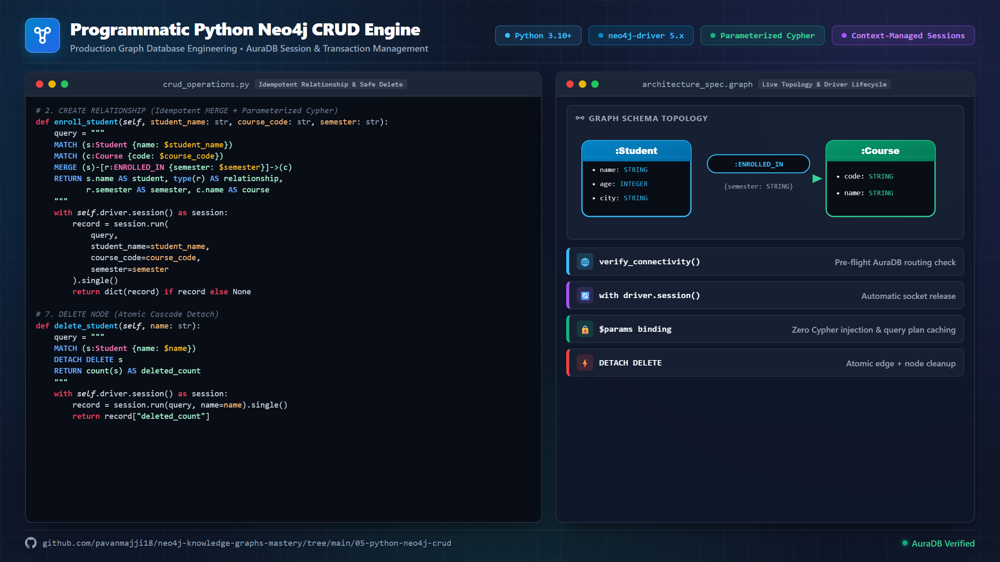
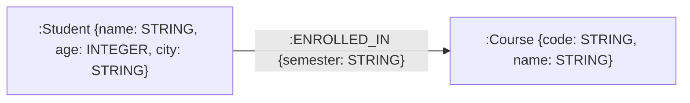
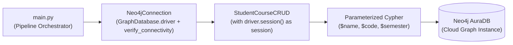

# 🛠️ 05. Programmatic Python Neo4j CRUD Engine

[](https://www.python.org/)
[](https://neo4j.com/)
[]()

This module provides a production-oriented, object-oriented Python implementation for executing **Create, Read, Update, and Delete (CRUD)** operations against **Neo4j AuraDB**. It demonstrates driver connection management, parameter sanitization, transaction sessions, and exception handling.

---

## 🕸️ Graph Schema & Driver Architecture

### Visual Architecture & Developer Showcase



### 1. Graph Data Model Topology

The database schema models students and academic courses connected by enrollment relationships with temporal semester metadata:



- **`(:Student)` Node**: Represents enrolled learners identified by `name` (STRING), `age` (INTEGER), and residential `city` (STRING).
- **`(:Course)` Node**: Represents curriculum courses uniquely indexed by `code` (STRING) and titled by `name` (STRING).
- **`[:ENROLLED_IN]` Relationship**: Directed attributed edge from `Student` to `Course` bearing `semester` (STRING) metadata.

### 2. Driver & Execution Lifecycle

The pipeline follows a clean separation of concerns, decoupling driver connection pooling from operational domain logic with context-managed sessions:

```mermaid
sequenceDiagram
    autonumber
    actor App as main.py
    participant Conn as Neo4jConnection<br/>(GraphDatabase.driver)
    participant CRUD as StudentCourseCRUD<br/>(driver.session())
    participant Driver as Parameterized Cypher<br/>($name, $code, $semester)
    participant AuraDB as Neo4j AuraDB<br/>(Cloud Instance)

    App->>Conn: 1. Initialize & verify_connection()
    Conn->>AuraDB: driver.verify_connectivity()
    AuraDB-->>Conn: Connectivity confirmed
    Conn-->>App: "Connected to Neo4j Aura successfully."
    App->>CRUD: 2. StudentCourseCRUD(conn.driver)
    
    rect rgb(20, 30, 45)
        Note over App,AuraDB: Parameterized CRUD Operation Lifecycle (e.g. enroll_student)
        App->>CRUD: enroll_student(student_name, course_code, semester)
        CRUD->>CRUD: with self.driver.session() as session
        CRUD->>Driver: session.run(query, student_name=..., course_code=..., semester=...)
        Driver->>AuraDB: Execute Cypher with parameter dictionary ($params)
        AuraDB-->>Driver: Return record stream
        Driver-->>CRUD: record.single()
        CRUD->>CRUD: Unpack Record to dict & auto-close session (socket release)
        CRUD-->>App: Return dict(record)
    end

    App->>Conn: 3. conn.close() (finally block)
    Conn->>AuraDB: Terminate driver connection pool
```





---

## 🎯 Key Objectives & Engineering Standards

1. **Object-Oriented Design**: Encapsulates database operations inside a clean Python class ([`StudentCourseCRUD`](crud_operations.py)).
2. **Parameterized Queries**: Prevents Cypher injection attacks by binding variables through parameters dictionary (`$name`, `$age`, `$city`).
3. **Session Lifecycle Management**: Utilizes Python context managers (`with self.driver.session() as session`) to prevent socket leaks.
4. **Transaction Safety**: Manages node creation, relationship linking (`:ENROLLED_IN`), property mutation (`SET`), and relationship-safe node deletion (`DETACH DELETE`).

---

## 📁 Architecture & File Structure

```text
05-python-neo4j-crud/
├── assets/
│   └── linkedin_visual.png  # High-resolution (2400x1350 @2x) architecture visual card
├── connection.py            # Neo4jConnection class managing driver lifecycle
├── crud_operations.py       # StudentCourseCRUD class implementing parameterized CRUD
├── main.py                  # Execution pipeline demonstrating end-to-end CRUD
├── requirements.txt         # Dependencies (neo4j, python-dotenv)
└── README.md                # Module documentation
```

---

## ⚙️ Core Class API Reference (`StudentCourseCRUD`)

| Method Signature | Operation | Description | Cypher Clause Used |
|---|---|---|---|
| `create_student(name, age, city)` | Create Node | Creates a new `Student` node. | `CREATE (s:Student {...})` |
| `create_course(course_name, code)` | Create Node | Merges a `Course` node idempotently. | `MERGE (c:Course {code: $code})` |
| `enroll_student(student_name, course_code, semester)` | Create Edge | Connects student to course with edge metadata. | `MATCH ... MERGE (s)-[r:ENROLLED_IN]->(c)` |
| `get_all_students()` | Read Nodes | Fetches all student records as Python dictionaries. | `MATCH (s:Student) RETURN ...` |
| `find_students_by_city(city)` | Filter/Search | Queries students matching exact city attribute. | `MATCH (s:Student) WHERE s.city = $city` |
| `update_student_age(name, new_age)` | Update Property | Mutates node properties in place. | `MATCH (s:Student) SET s.age = $new_age` |
| `remove_enrollment(student_name, course_code)` | Delete Edge | Removes relationship between student & course. | `MATCH ...-[r:ENROLLED_IN]->... DELETE r` |
| `delete_student(name)` | Delete Node | Safely deletes student node & connected edges. | `MATCH (s:Student) DETACH DELETE s` |

---

## 🔍 Code Deep Dive: Parameterized Cypher

### Injection-Safe Relationship Creation
```python
def enroll_student(self, student_name: str, course_code: str, semester: str):
    query = """
    MATCH (s:Student {name: $student_name})
    MATCH (c:Course {code: $course_code})
    MERGE (s)-[r:ENROLLED_IN {semester: $semester}]->(c)
    RETURN s.name AS student, type(r) AS relationship, r.semester AS semester, c.name AS course
    """
    with self.driver.session() as session:
        record = session.run(
            query,
            student_name=student_name,
            course_code=course_code,
            semester=semester
        ).single()
        return dict(record) if record else None
```

---

## 🚀 Quick Start & Sample Execution Output

### Environment Setup & Execution

```bash
# 1. Navigate to directory
cd 05-python-neo4j-crud

# 2. Activate virtual environment
python -m venv venv
# Windows (PowerShell):
.\venv\Scripts\Activate.ps1
# macOS/Linux:
# source venv/bin/activate

# 3. Install dependencies
pip install -r requirements.txt

# 4. Copy environment configuration
cp .env.example .env
# Edit .env with your Neo4j AuraDB credentials:
# NEO4J_URI=neo4j+s://<dbid>.databases.neo4j.io
# NEO4J_USERNAME=neo4j
# NEO4J_PASSWORD=<your_password>

# 5. Run the full CRUD pipeline
python main.py
```

### Verified Terminal Output

```text
Connected to Neo4j Aura successfully.

--- 1. Creating Nodes ---
Created: {'name': 'Alice Smith', 'age': 22, 'city': 'Seattle'}

--- 2. Creating Relationship ---
Relationship: {'student': 'Alice Smith', 'relationship': 'ENROLLED_IN', 'semester': 'Fall 2026', 'course': 'Knowledge Graphs 101'}

--- 3. Reading All Students ---
[{'name': 'Alice Smith', 'age': 22, 'city': 'Seattle'}]

--- 4. Filtering By City (Seattle) ---
[{'name': 'Alice Smith', 'age': 22, 'city': 'Seattle'}]

--- 5. Updating Properties ---
Updated Student: {'name': 'Alice Smith', 'age': 23, 'city': 'Seattle'}

--- 6. Deleting Relationship ---
Enrollments Removed: 1

--- 7. Deleting Node ---
Nodes Removed: 1

Connection closed.
```

---

## 🎤 How to Explain This Project to Technical Reviewers

- **For Technical Screeners**: *"In this project, I built a reusable Python CRUD engine for Neo4j. I separated driver connection pooling ([`connection.py`](connection.py)) from operational query logic ([`crud_operations.py`](crud_operations.py)), ensured all Cypher queries use parameter maps to prevent injection, and used `DETACH DELETE` to maintain graph integrity during node deletion."*
- **For Non-Technical Managers**: *"This module proves we can build software that creates, retrieves, updates, and deletes records in our graph database safely without risking data corruption."*
