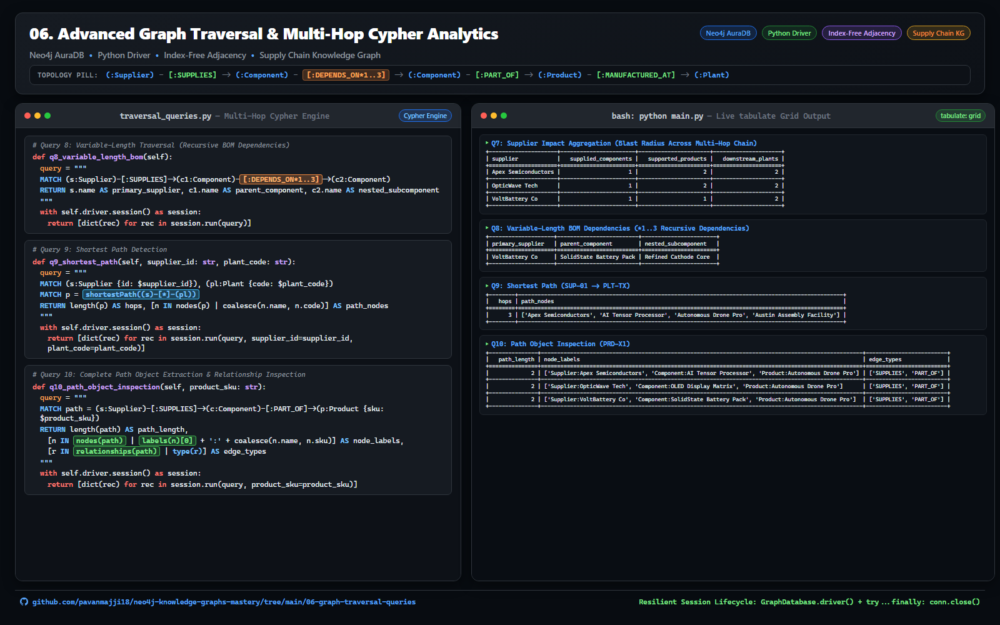

# 🧭 06. Advanced Graph Traversal & Multi-Hop Cypher Analytics

[](https://neo4j.com/docs/cypher-manual/current/)
[]()
[]()
[]()

This project demonstrates **10 advanced graph traversal and analytical queries** in Cypher using Python and **Neo4j AuraDB**. It covers single-hop traversals, 4-hop chain traversals, path property filtering, direction analysis, fan-out aggregations, variable-length recursive traversals (`*1..3`), shortest path detection (`shortestPath()`), and path object inspection (`nodes(path)`, `relationships(path)`).

---

## 🖼️ Architectural Showcase & Live Output



---

## 📐 Graph Topology & Data Model

```text
(:Supplier) -[:SUPPLIES]-> (:Component) -[:PART_OF]-> (:Product) -[:MANUFACTURED_AT]-> (:Plant)
                                |
                                +--[:DEPENDS_ON*1..3]-> (:Component)
```

- **Domain**: Global High-Tech Manufacturing Supply Chain.
- **Node Labels**: `Supplier`, `Component`, `Product`, `Plant`.
- **Relationship Types**: `:SUPPLIES`, `:PART_OF`, `:MANUFACTURED_AT`, `:DEPENDS_ON`.

### Schema Uniqueness Constraints (Neo4j 5.x)
To ensure idempotent graph initialization and maintain referential integrity across multi-hop relationships, 4 primary-key uniqueness constraints are verified prior to node insertion:

```cypher
CREATE CONSTRAINT supplier_id_unique IF NOT EXISTS FOR (s:Supplier) REQUIRE s.id IS UNIQUE;
CREATE CONSTRAINT component_id_unique IF NOT EXISTS FOR (c:Component) REQUIRE c.id IS UNIQUE;
CREATE CONSTRAINT product_sku_unique IF NOT EXISTS FOR (p:Product) REQUIRE p.sku IS UNIQUE;
CREATE CONSTRAINT plant_code_unique IF NOT EXISTS FOR (pl:Plant) REQUIRE pl.code IS UNIQUE;
```

---

## 📁 Architecture & Key Files

- [`connection.py`](connection.py): Neo4j driver connection manager utilizing `NEO4J_URI`, `NEO4J_USERNAME`, and `NEO4J_PASSWORD`.
- [`seed_graph.py`](seed_graph.py): Idempotent seeding pipeline creating Neo4j 5.x uniqueness constraints and populating suppliers, components, products, and plants.
- [`traversal_queries.py`](traversal_queries.py): `GraphTraversalQueries` class encapsulating all 10 multi-hop Cypher traversal and path algorithms.
- [`main.py`](main.py): CLI runner executing queries and printing formatted `tabulate` grid results.
- [`generate_visual.py`](generate_visual.py): Headless renderer generating high-resolution split-screen LinkedIn visual attachments.
- [`assets/`](assets/): Contains the 1600x1000 showcase visual (`linkedin_visual_06_graph_traversal.png`) and HTML template (`card_template.html`).
- [`requirements.txt`](requirements.txt): Module Python dependencies (`neo4j`, `python-dotenv`, `tabulate`).

---

## 🔍 Master Catalog of 10 Cypher Queries

| # | Query Pattern | Cypher Keyword / Concept | Description |
|---|---|---|---|
| **Q1** | Single-Hop Outgoing | `(s)-[:SUPPLIES]->(c)` | Finds all components supplied by a named supplier. |
| **Q2** | Single-Hop Incoming | `(p)<-[:PART_OF]-(c)` | Finds all components required for a specific product SKU. |
| **Q3** | Two-Hop Traversal | `(s)->(c)->(p)` | Maps suppliers in a target country to impacted end products. |
| **Q4** | 4-Node Chain | `(s)->(c)->(p)->(pl)` | Full end-to-end chain from supplier to manufacturing plant. |
| **Q5** | Path Property Filtering | `WHERE c.lead_time >= X AND pl.country = Y` | Filters paths based on component lead time & plant country. |
| **Q6** | Direction Analysis | `(c1)-[:PART_OF]->(p)<-[:PART_OF]-(c2)` | Finds co-occurring companion components sharing end products. |
| **Q7** | Fan-Out Aggregation | `count(DISTINCT p), count(DISTINCT pl)` | Computes downstream product & plant blast radius per supplier. |
| **Q8** | Variable-Length Recursive | `-[:DEPENDS_ON*1..3]->` | Traverses multi-level nested subcomponents in Bill-of-Materials. |
| **Q9** | Shortest Path | `shortestPath((s)-[*]-(pl))` | Discovers minimum hop distance between supplier & plant nodes. |
| **Q10** | Path Object Inspection | `nodes(path)`, `relationships(path)` | Extracts raw node labels and edge types along path instance. |

---

## 📊 Sample CLI Execution Output

The table projections below display the exact output of `python main.py` formatted with `tabulate(..., tablefmt="grid")`:

### Q4: 4-Hop Full Chain Traversal
```text
+---------------------+-------------------------+----------------------+----------------------------+-----------------+
| supplier            | component               | product              | plant                      | plant_country   |
+=====================+=========================+======================+============================+=================+
| Apex Semiconductors | AI Tensor Processor     | Autonomous Drone Pro | Austin Assembly Facility   | USA             |
+---------------------+-------------------------+----------------------+----------------------------+-----------------+
| OpticWave Tech      | OLED Display Matrix     | Autonomous Drone Pro | Austin Assembly Facility   | USA             |
+---------------------+-------------------------+----------------------+----------------------------+-----------------+
| VoltBattery Co      | SolidState Battery Pack | Autonomous Drone Pro | Austin Assembly Facility   | USA             |
+---------------------+-------------------------+----------------------+----------------------------+-----------------+
| Apex Semiconductors | AI Tensor Processor     | Autonomous Drone Pro | Stuttgart Automation Works | Germany         |
+---------------------+-------------------------+----------------------+----------------------------+-----------------+
| OpticWave Tech      | OLED Display Matrix     | Autonomous Drone Pro | Stuttgart Automation Works | Germany         |
+---------------------+-------------------------+----------------------+----------------------------+-----------------+
| VoltBattery Co      | SolidState Battery Pack | Autonomous Drone Pro | Stuttgart Automation Works | Germany         |
+---------------------+-------------------------+----------------------+----------------------------+-----------------+
| Apex Semiconductors | AI Tensor Processor     | Edge AI Vision Hub   | Stuttgart Automation Works | Germany         |
+---------------------+-------------------------+----------------------+----------------------------+-----------------+
| OpticWave Tech      | OLED Display Matrix     | Edge AI Vision Hub   | Stuttgart Automation Works | Germany         |
+---------------------+-------------------------+----------------------+----------------------------+-----------------+
```

### Q5: Filtered Traversal (Lead Time >= 40, Plant USA)
```text
+---------------------+-------------------------+-------------+----------------------+--------------------------+
| supplier            | component               |   lead_time | product              | plant                    |
+=====================+=========================+=============+======================+==========================+
| Apex Semiconductors | AI Tensor Processor     |          45 | Autonomous Drone Pro | Austin Assembly Facility |
+---------------------+-------------------------+-------------+----------------------+--------------------------+
| VoltBattery Co      | SolidState Battery Pack |          60 | Autonomous Drone Pro | Austin Assembly Facility |
+---------------------+-------------------------+-------------+----------------------+--------------------------+
```

### Q7: Supplier Impact Aggregation
```text
+---------------------+-----------------------+----------------------+---------------------+
| supplier            |   supplied_components |   supported_products |   downstream_plants |
+=====================+=======================+======================+=====================+
| Apex Semiconductors |                     1 |                    2 |                   2 |
+---------------------+-----------------------+----------------------+---------------------+
| OpticWave Tech      |                     1 |                    2 |                   2 |
+---------------------+-----------------------+----------------------+---------------------+
| VoltBattery Co      |                     1 |                    1 |                   2 |
+---------------------+-----------------------+----------------------+---------------------+
```

### Q8: Variable-Length BOM Dependencies
```text
+--------------------+-------------------------+-----------------------+
| primary_supplier   | parent_component        | nested_subcomponent   |
+====================+=========================+=======================+
| VoltBattery Co     | SolidState Battery Pack | Refined Cathode Core  |
+--------------------+-------------------------+-----------------------+
```

### Q9: Shortest Path (SUP-01 -> PLT-TX)
```text
+--------+----------------------------------------------------------------------------------------------------+
|   hops | path_nodes                                                                                         |
+========+====================================================================================================+
|      3 | ['Apex Semiconductors', 'AI Tensor Processor', 'Autonomous Drone Pro', 'Austin Assembly Facility'] |
+--------+----------------------------------------------------------------------------------------------------+
```

### Q10: Path Object Inspection (PRD-X1)
```text
+---------------+---------------------------------------------------------------------------------------------------+-------------------------+
|   path_length | node_labels                                                                                       | edge_types              |
+===============+===================================================================================================+=========================+
|             2 | ['Supplier:Apex Semiconductors', 'Component:AI Tensor Processor', 'Product:Autonomous Drone Pro'] | ['SUPPLIES', 'PART_OF'] |
+---------------+---------------------------------------------------------------------------------------------------+-------------------------+
|             2 | ['Supplier:OpticWave Tech', 'Component:OLED Display Matrix', 'Product:Autonomous Drone Pro']      | ['SUPPLIES', 'PART_OF'] |
+---------------+---------------------------------------------------------------------------------------------------+-------------------------+
|             2 | ['Supplier:VoltBattery Co', 'Component:SolidState Battery Pack', 'Product:Autonomous Drone Pro']  | ['SUPPLIES', 'PART_OF'] |
+---------------+---------------------------------------------------------------------------------------------------+-------------------------+
```

<details>
<summary><b>View Full Q1–Q10 CLI Output (Click to Expand)</b></summary>

```text
Connected to Neo4j Aura successfully.
Schema uniqueness constraints verified.
Supply chain graph seeded successfully.

=======================================================
 Q1: Single-Hop Outgoing (Apex Semiconductors)
=======================================================
+---------------------+----------------+---------------------+--------+
| supplier            | relationship   | component           |   cost |
+=====================+================+=====================+========+
| Apex Semiconductors | SUPPLIES       | AI Tensor Processor |    210 |
+---------------------+----------------+---------------------+--------+

=======================================================
 Q2: Single-Hop Incoming (Components of Drone Pro)
=======================================================
+----------------------+-------------------------+-------+
| product              | component               |   qty |
+======================+=========================+=======+
| Autonomous Drone Pro | AI Tensor Processor     |     1 |
+----------------------+-------------------------+-------+
| Autonomous Drone Pro | OLED Display Matrix     |     1 |
+----------------------+-------------------------+-------+
| Autonomous Drone Pro | SolidState Battery Pack |     1 |
+----------------------+-------------------------+-------+

=======================================================
 Q3: Two-Hop (Taiwan Suppliers to Downstream Products)
=======================================================
+---------------------+-----------+---------------------+----------------------+
| supplier            | country   | component           | impacted_product     |
+=====================+===========+=====================+======================+
| Apex Semiconductors | Taiwan    | AI Tensor Processor | Autonomous Drone Pro |
+---------------------+-----------+---------------------+----------------------+
| Apex Semiconductors | Taiwan    | AI Tensor Processor | Edge AI Vision Hub   |
+---------------------+-----------+---------------------+----------------------+

=======================================================
 Q4: Multi-Hop 4-Node Chain (Supplier -> Component -> Product -> Plant)
=======================================================
+---------------------+-------------------------+----------------------+----------------------------+-----------------+
| supplier            | component               | product              | plant                      | plant_country   |
+=====================+=========================+======================+============================+=================+
| Apex Semiconductors | AI Tensor Processor     | Autonomous Drone Pro | Austin Assembly Facility   | USA             |
+---------------------+-------------------------+----------------------+----------------------------+-----------------+
| OpticWave Tech      | OLED Display Matrix     | Autonomous Drone Pro | Austin Assembly Facility   | USA             |
+---------------------+-------------------------+----------------------+----------------------------+-----------------+
| VoltBattery Co      | SolidState Battery Pack | Autonomous Drone Pro | Austin Assembly Facility   | USA             |
+---------------------+-------------------------+----------------------+----------------------------+-----------------+
| Apex Semiconductors | AI Tensor Processor     | Autonomous Drone Pro | Stuttgart Automation Works | Germany         |
+---------------------+-------------------------+----------------------+----------------------------+-----------------+
| OpticWave Tech      | OLED Display Matrix     | Autonomous Drone Pro | Stuttgart Automation Works | Germany         |
+---------------------+-------------------------+----------------------+----------------------------+-----------------+
| VoltBattery Co      | SolidState Battery Pack | Autonomous Drone Pro | Stuttgart Automation Works | Germany         |
+---------------------+-------------------------+----------------------+----------------------------+-----------------+
| Apex Semiconductors | AI Tensor Processor     | Edge AI Vision Hub   | Stuttgart Automation Works | Germany         |
+---------------------+-------------------------+----------------------+----------------------------+-----------------+
| OpticWave Tech      | OLED Display Matrix     | Edge AI Vision Hub   | Stuttgart Automation Works | Germany         |
+---------------------+-------------------------+----------------------+----------------------------+-----------------+

=======================================================
 Q5: Filtered Multi-Hop (Lead Time >= 30 days & USA Active Line)
=======================================================
+---------------------+-------------------------+-------------+----------------------+--------------------------+
| supplier            | component               |   lead_time | product              | plant                    |
+=====================+=========================+=============+======================+==========================+
| Apex Semiconductors | AI Tensor Processor     |          45 | Autonomous Drone Pro | Austin Assembly Facility |
+---------------------+-------------------------+-------------+----------------------+--------------------------+
| OpticWave Tech      | OLED Display Matrix     |          30 | Autonomous Drone Pro | Austin Assembly Facility |
+---------------------+-------------------------+-------------+----------------------+--------------------------+
| VoltBattery Co      | SolidState Battery Pack |          60 | Autonomous Drone Pro | Austin Assembly Facility |
+---------------------+-------------------------+-------------+----------------------+--------------------------+

=======================================================
 Q6: Direction Analysis (Components sharing products with AI Tensor Processor)
=======================================================
+----------------------+----------------------------------------------------+
| shared_product       | companion_components                               |
+======================+====================================================+
| Autonomous Drone Pro | ['OLED Display Matrix', 'SolidState Battery Pack'] |
+----------------------+----------------------------------------------------+
| Edge AI Vision Hub   | ['OLED Display Matrix']                            |
+----------------------+----------------------------------------------------+

=======================================================
 Q7: Aggregation / Blast Radius Across Multi-Hop Chain
=======================================================
+---------------------+-----------------------+----------------------+---------------------+
| supplier            |   supplied_components |   supported_products |   downstream_plants |
+=====================+=======================+======================+=====================+
| Apex Semiconductors |                     1 |                    2 |                   2 |
+---------------------+-----------------------+----------------------+---------------------+
| OpticWave Tech      |                     1 |                    2 |                   2 |
+---------------------+-----------------------+----------------------+---------------------+
| VoltBattery Co      |                     1 |                    1 |                   2 |
+---------------------+-----------------------+----------------------+---------------------+

=======================================================
 Q8: Variable-Length Traversal (*1..3 Recursive Dependencies)
=======================================================
+--------------------+-------------------------+-----------------------+
| primary_supplier   | parent_component        | nested_subcomponent   |
+====================+=========================+=======================+
| VoltBattery Co     | SolidState Battery Pack | Refined Cathode Core  |
+--------------------+-------------------------+-----------------------+

=======================================================
 Q9: Shortest Path (RawLithium Ltd SUP-04 to Austin Plant PLT-TX)
=======================================================
+--------+---------------------------------------------------------------------------------------------------------------------------+
|   hops | path_nodes                                                                                                                |
+========+===========================================================================================================================+
|      4 | ['RawLithium Ltd', 'Refined Cathode Core', 'SolidState Battery Pack', 'Autonomous Drone Pro', 'Austin Assembly Facility'] |
+--------+---------------------------------------------------------------------------------------------------------------------------+

=======================================================
 Q10: Path Object Inspection (Node labels and Edge Types for PRD-M2)
=======================================================
+---------------+-------------------------------------------------------------------------------------------------+-------------------------+
|   path_length | node_labels                                                                                     | edge_types              |
+===============+=================================================================================================+=========================+
|             2 | ['Supplier:Apex Semiconductors', 'Component:AI Tensor Processor', 'Product:Edge AI Vision Hub'] | ['SUPPLIES', 'PART_OF'] |
+---------------+-------------------------------------------------------------------------------------------------+-------------------------+
|             2 | ['Supplier:OpticWave Tech', 'Component:OLED Display Matrix', 'Product:Edge AI Vision Hub']      | ['SUPPLIES', 'PART_OF'] |
+---------------+-------------------------------------------------------------------------------------------------+-------------------------+

All queries executed. Connection closed.
```
</details>

---

## 💻 Featured Cypher Code Snippets

### Q8: Variable-Length Recursive BOM Traversal (`*1..3`)
```cypher
MATCH (s:Supplier)-[:SUPPLIES]->(c1:Component)-[:DEPENDS_ON*1..3]->(c2:Component)
RETURN s.name AS primary_supplier, 
       c1.name AS parent_component, 
       c2.name AS nested_subcomponent
```

### Q9: Shortest Path Calculation
```cypher
MATCH (s:Supplier {id: $supplier_id}), (pl:Plant {code: $plant_code})
MATCH p = shortestPath((s)-[*]-(pl))
RETURN length(p) AS hops, 
       [n IN nodes(p) | coalesce(n.name, n.code)] AS path_nodes
```

### Q10: Path Object & Edge Type Extraction
```cypher
MATCH path = (s:Supplier)-[:SUPPLIES]->(c:Component)-[:PART_OF]->(p:Product {sku: $product_sku})
RETURN length(path) AS path_length,
       [n IN nodes(path) | labels(n)[0] + ':' + coalesce(n.name, n.sku)] AS node_labels,
       [r IN relationships(path) | type(r)] AS edge_types
```

---

## ⚡ Step-by-Step Setup & Execution

```bash
# 1. Navigate to directory
cd 06-graph-traversal-queries

# 2. Activate virtual environment & install dependencies
python -m venv venv
.\venv\Scripts\activate  # macOS/Linux: source venv/bin/activate
pip install -r requirements.txt

# 3. Seed dataset & run all 10 traversal queries
python main.py
```

---

## 🎤 How to Explain This Project to Technical Reviewers

- **For Technical Screeners**: *"In this project, I implemented 10 multi-hop Cypher traversal patterns. I used variable-length path matching `*1..3` for recursive Bill-of-Materials, `shortestPath()` for graph distance calculation, and fan-out aggregations like `count(DISTINCT plant)` to measure vendor blast radius."*
- **For Non-Technical Managers**: *"This module showcases how Neo4j can instantly trace complex multi-step supply chains and calculate shortest routes between raw material vendors and factories."*
